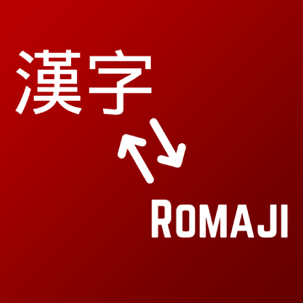

  

# Japanese Romaji

Learn Japanese vocabulary while playing Minecraft. This resource pack keeps the original Japanese text and adds its romaji reading in parentheses.

**Minecraft Java Edition 1.21.1 · v0.3.0-beta.1 · 6,506 annotated entries**

[Download the beta](https://github.com/atombiote/japanese-romaji/releases) · [Report a reading issue](https://github.com/atombiote/japanese-romaji/issues)

> **NOT AN OFFICIAL MINECRAFT PRODUCT. NOT APPROVED BY OR ASSOCIATED WITH MOJANG OR MICROSOFT.**

## Examples

| Japanese | With the pack |
| --- | --- |
| ダイヤモンドの剣 | ダイヤモンドの剣 (daiyamondo no ken) |
| オークの原木 | オークの原木 (ōku no genboku) |
| 鉄の斧 | 鉄の斧 (tetsu no ono) |
| 言語設定 | 言語設定 (gengo settei) |

## Install

1. Download **Japanese-Romaji-1.21.1-v0.3.0-beta.1-full.zip** from [Releases](https://github.com/atombiote/japanese-romaji/releases). Keep it zipped.
2. In Minecraft, open **Options → Resource Packs → Open Pack Folder**.
3. Copy the ZIP into that folder and enable it above other packs that change Japanese text.
4. Select **日本語 (日本)** in the language settings.
5. Disable older Japanese Romaji versions when updating.

This is a resource pack. No additional mod, loader, Python installation or dictionary is needed to play. Other languages remain unchanged.

## Coverage

The pack annotates available Japanese text for vanilla blocks, items, mobs, enchantments, effects, biomes, advancements, subtitles, menus, options and messages. It includes all sword and wood entries from earlier versions.

Japanese characters, punctuation, formatting codes, line breaks and runtime placeholders are preserved. Fixed parts of messages receive readings without duplicating player-name or number placeholders.

Three technical language-metadata entries and strings without Japanese script are left as supplied by Minecraft. The installed Japanese asset lacks translations for 93 older keys; those retain their existing English fallback. Player-written text, other mods' translations and separate assets such as the English End Poem are outside the language-key scope.

See [COVERAGE.md](COVERAGE.md) for the coverage accounting.

## Reading romaji

Readings use lowercase Hepburn-style romaji with spaces between words.

- **ā, ē, ī, ō, ū** indicate long vowels. For example, **オーク → ōku**.
- **ii** can also indicate a long i, as in **tamashii**.
- An apostrophe separates n from a following vowel: **kan'atsuban**.
- Particles は, へ and を are written **wa**, **e** and **o** where identified as particles.

Spaces are a reading aid rather than a syllable breakdown. Romaji does not show pitch accent. Arabic digits and Latin abbreviations remain digits and letters.

## Beta limitations

Most readings were generated using a Japanese morphological dictionary and then corrected for selected Minecraft terms. The complete list has **not received independent human Japanese proofreading**. Some context-sensitive readings or word divisions may be wrong.

Longer names and menu labels may clip at some GUI scales. Narrator speech also encounters the added Latin text. Mechanical checks validate the original text, formatting and coverage; they do not establish pronunciation accuracy or a complete in-game compatibility test.

For a correction, [open an issue](https://github.com/atombiote/japanese-romaji/issues) with the Japanese text, displayed reading and suggested reading. A screenshot and the relevant translation key are helpful.

## Building

The editable resource-pack files are in **pack/**. Run **./build.ps1** in PowerShell to rebuild the current release ZIP in **dist/**.

[BUILDING.md](BUILDING.md) describes dictionary generation and validation. Build-time requirements are listed in **requirements-build.txt** and are not included in the playable pack.

## Credits and rights

- **Project and original artwork:** atombiote.
- **Original Japanese text and identifiers:** Minecraft and their respective rights holders.
- **Build-time language tools:** SudachiPy and SudachiDict; see [THIRD-PARTY.md](THIRD-PARTY.md).
- Generative AI assisted project code, reading decisions and documentation.

Original project contributions and artwork are **All rights reserved**; see [LICENSE.txt](LICENSE.txt). This notice does not relicense Minecraft's original text or other third-party material.

**Contact:** atombiote@gmail.com
